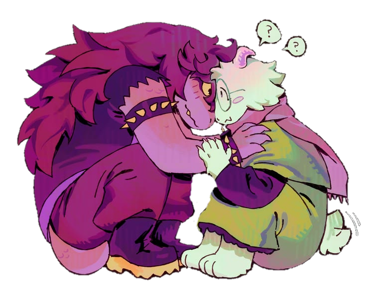

<!-- KHUNG 1: Banner to + Dòng chữ nhỏ bên phải -->
<table border="0" width="100%">
  <tr>
    <td width="65%" align="center">
      
    </td>
    <td width="35%" align="center">
      $$\color{#c8a2c8}\text{best on pc + dark mode}$$   
      $$\color{#ffb6c1}\text{sweetheart\ •\ deltarune}$$
    </td>
  </tr>
</table>

 

<!-- KHUNG 2: Chữ bên trái + Ảnh to bên phải -->
<table border="0" width="100%">
  <tr>
    <td width="40%" align="center">
      $$\color{#ffb6c1}\text{wow\ is\ that\ really\ ralsei}$$   
      $$\color{#c8a2c8}\text{susie\ x\ ralsei\ •\ meet-cute}$$   
      $$\color{#a2d2ff}\text{check\ links\ +\ sign\ my\ ata}$$
    </td>
    <td width="60%" align="center">
      
    </td>
  </tr>
</table>

 

<!-- KHUNG 3: Ghép 3 tấm ảnh nằm hàng ngang -->
<table border="0" width="100%">
  <tr>
    <td width="33%" align="center">
      
    </td>
    <td width="33%" align="center">
      
    </td>
    <td width="33%" align="center">
      
    </td>
  </tr>
</table>

 

<!-- KHUNG 4: Ảnh to bên trái + Chữ thơ bên phải -->
<table border="0" width="100%">
  <tr>
    <td width="60%" align="center">
      
    </td>
    <td width="40%" align="center">
      💉  
      $$\color{#ffb6c1}\text{roses\ are\ red}$$  
      $$\color{#c8a2c8}\text{violets\ are\ blue}$$  
      $$\color{#a2d2ff}\text{one\ is\ dead}$$  
      $$\color{#ef1f1f}\text{and\ so\ are\ you}$$
    </td>
  </tr>
</table>
