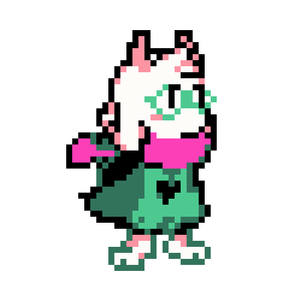
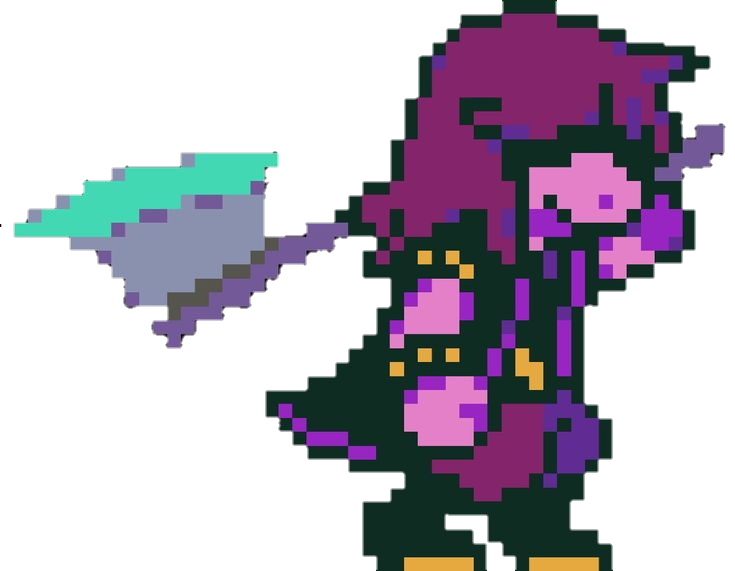
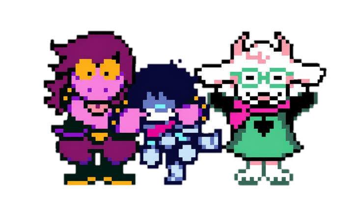

<!-- KHUNG 1: Banner chính Lớn (70%) + Ô Thơ Xếp Dọc Bên Phải (30%) -->
<table border="0" width="100%">
  <tr>
    <td width="70%" align="center">
      
    </td>
    <td width="30%" align="center">
      $$\color{#e8b4b8}\text{soft\ light}$$   
      $$\color{#dfb4db}\text{in\ the\ dark\ ♡}$$
    </td>
  </tr>
</table>

 

<!-- KHUNG 2: Chia 3 Ô Đều Nằm Ngang (Ảnh - Chữ Bio - Ảnh) -->
<table border="0" width="100%">
  <tr>
    <td width="33%" align="center">
      
    </td>
    <td width="34%" align="center">
      $$\color{#d8b4f8}\text{𓏽\ Dian\ 𓏽}$$   
      $$\color{#d0b5fc}\text{16↓\ •\ they/them}$$  
      $$\color{#c8b6ff}\text{multi\ fds\ •\ deltarune}$$   
      $$\color{#c0baff}\text{welcome\ to\ my\ space}$$
    </td>
    <td width="33%" align="center">
      
    </td>
  </tr>
</table>

 

<!-- KHUNG 3: Ô Thơ Nghệ Thuật Bên Trái (40%) + Ảnh To Bên Phải (60%) -->
<table border="0" width="100%">
  <tr>
    <td width="40%" align="center">
         
      $$\color{#bbadff}\text{stars\ don't\ shine}$$  
      $$\color{#b8c0ff}\text{without\ darkness,}$$   
      $$\color{#adcbfa}\text{and\ love\ is\ found}$$  
      $$\color{#a2c2e8}\text{in\ quiet\ places.}$$
    </td>
    <td width="60%" align="center">
      
    </td>
  </tr>
</table>

 

<!-- KHUNG 4: Dòng chữ Footer nhỏ căn giữa khép lại Profile -->

  $$\color{#a0c4ff}\text{►\ click\ links\ below\ •\ thanks\ for\ visiting\ my\ profile\ ♡}$$

